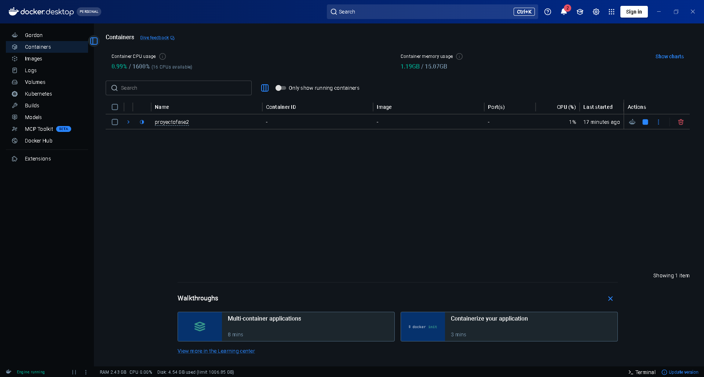
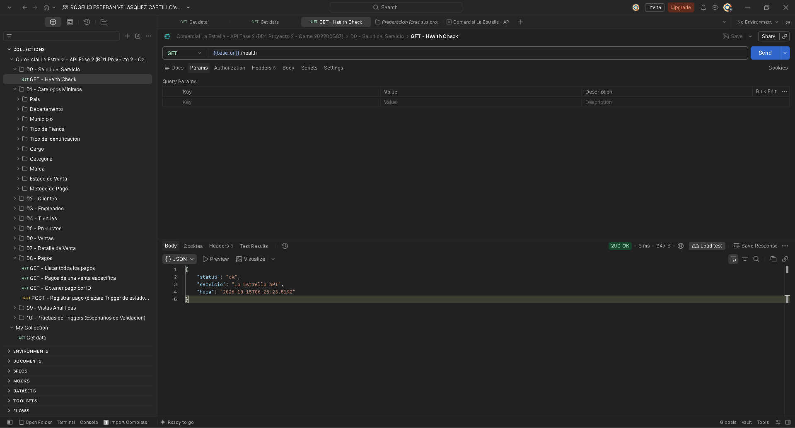
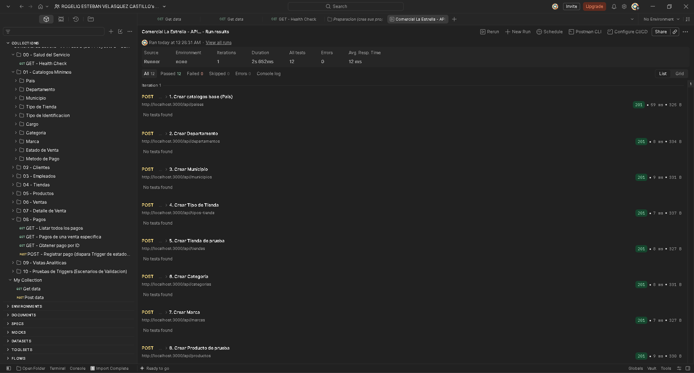
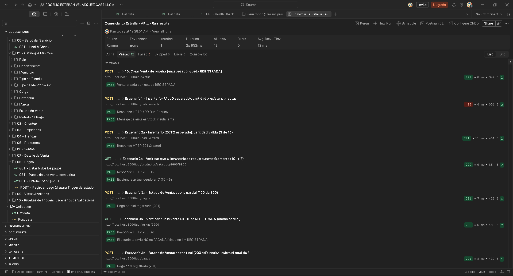
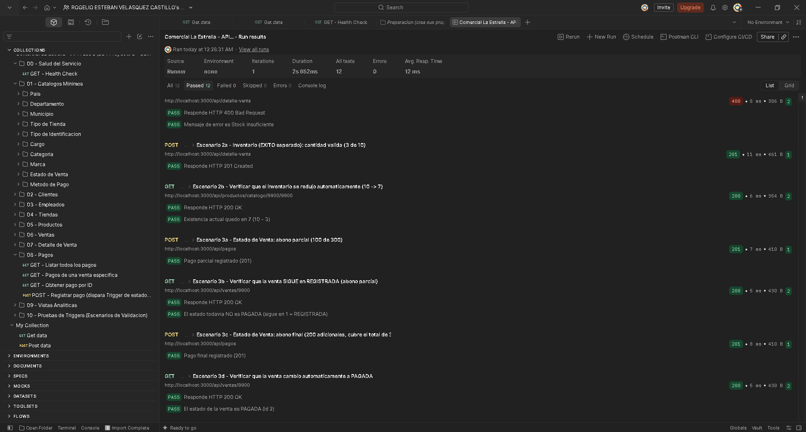
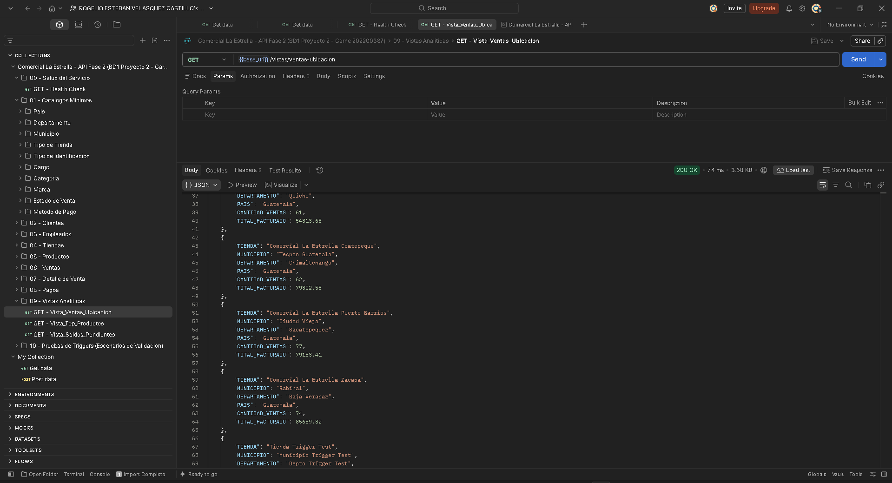
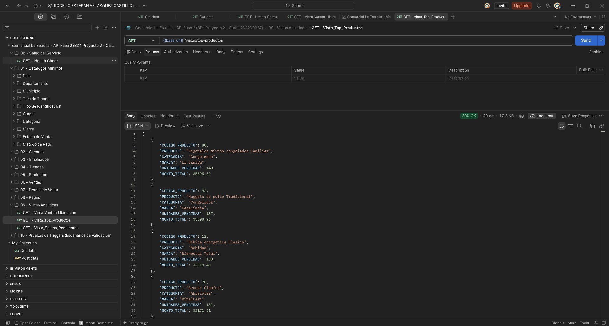
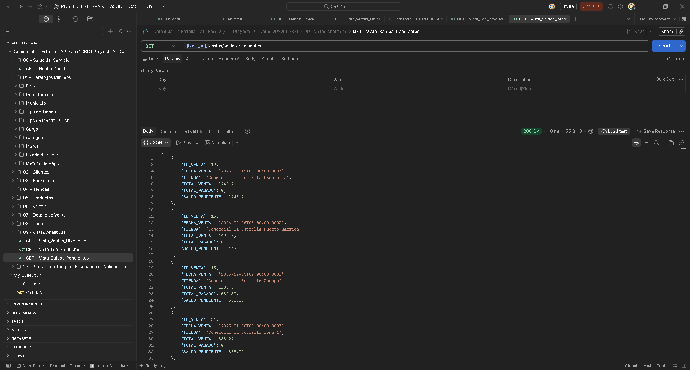

# Comercial La Estrella — Proyecto 2 (Fase 2)
Bases de Datos 1 — Universidad de San Carlos de Guatemala
Estudiante: Esteban Velásquez  — Carné 202200387
Repositorio en GitHub: https://github.com/EstebanVelasquezC/BD1_ProyectoFase2_202200387

Backend y exposición de servicios para la base de datos "Comercial La
Estrella", migrada de Oracle (Fase 1) a **Microsoft SQL Server 2022**,
dockerizada, y expuesta exclusivamente a través de un **API REST en
Node.js / Express**, con reglas de negocio delegadas al motor de base de
datos mediante **2 Triggers** y **3 Vistas** analíticas.

## 1. Arquitectura

```
                 ┌────────────────────┐        ┌──────────────────────┐
  Postman   ───► │   API REST         │  mssql │  SQL Server 2022      │
  (cliente) ───► │   Node.js/Express  │ ─────► │  (contenedor Docker)  │
                 │   puerto 3000      │        │  puerto 1433          │
                 └────────────────────┘        └──────────────────────┘
```

Ningún cliente externo (ni Postman, ni DBeaver, ni el script de carga)
se conecta jamás directamente a SQL Server para manipular datos. DBeaver
solo se usa para **verificar la estructura** (solo lectura); toda
inserción, actualización y eliminación pasa por el API.

## 2. Estructura del proyecto

```
ProyectoFase2/
├── docker-compose.yml        # Infraestructura: SQL Server 2022 + API
├── init.sql                  # DDL: 19 tablas, triggers, vistas
├── api/                      # Código fuente del API REST
│   ├── server.js
│   ├── package.json
│   ├── Dockerfile
│   ├── config/db.js          # Conexión a SQL Server (mssql)
│   ├── controllers/          # Lógica por entidad
│   └── routes/                # Rutas por entidad
├── seed/                     # Carga de datos (vía API, no SQL directo)
│   ├── cargar_datos.js
│   ├── carga_datos_fase1.sql # Dataset validado de la Fase 1 (fuente)
│   └── package.json
└── postman/
    └── La_Estrella_API.postman_collection.json
```

## 3. Requisitos previos

- Docker Desktop (o motor Docker en Linux/Mac) y docker-compose.
- Node.js 18+ (solo si se quiere correr el script de carga fuera de
  Docker; el API ya corre dentro de su propio contenedor).
- Postman.
- (Opcional) DBeaver, únicamente para verificación estructural de solo
  lectura.

## 4. Levantar la infraestructura (Docker)

Desde la raíz de `ProyectoFase2/`:

```bash
docker-compose up --build
```

Esto hace, en orden:

1. Levanta el contenedor `sqlserver` (SQL Server 2022) y espera a que
   el *healthcheck* confirme que el motor ya acepta conexiones.
2. Levanta el contenedor `sqlserver-init`, que ejecuta automáticamente
   `init.sql` contra la base de datos `ComercialLaEstrella` (crea las
   19 tablas, las llaves, los 2 triggers y las 3 vistas) y luego se
   detiene (es un contenedor de un solo uso).
3. Levanta el contenedor `api`, que expone el servicio en
   `http://localhost:3000/api`.

Para confirmar que todo quedó arriba:

```bash
docker-compose ps
curl http://localhost:3000/api/health
```

**Captura 1 — Contenedores levantados en Docker Desktop**
(`sqlserver` y `api` en ejecución; `sqlserver-init` es de un solo uso y
termina por diseño):



**Captura 2 — Health check del API (Postman):**



### Verificación estructural (solo lectura, opcional)

Con DBeaver, conectar a `localhost:1433`, usuario `sa`, contraseña la
definida en `SA_PASSWORD` (por defecto `LaEstrella#2026`, ver
`docker-compose.yml`), base de datos `ComercialLaEstrella`, y revisar
que existan las 19 tablas, los triggers `trg_DesgloseVenta_Insert_Detalle`
y `trg_Pago_Insert_Pago`, y las vistas `Vista_Ventas_Ubicacion`,
`Vista_Top_Productos` y `Vista_Saldos_Pendientes`. **No se realiza
ninguna inserción, actualización ni eliminación desde aquí.**

## 5. Cargar los datos (vía API)

El script `seed/cargar_datos.js` reproduce el dataset ya validado de la
Fase 1 (`seed/carga_datos_fase1.sql`, el mismo que obtuvo 100/100 en el
proyecto anterior) llamando **exclusivamente** a los endpoints del API,
en el orden correcto de dependencias.

```bash
cd ProyectoFase2/seed
npm install   # no tiene dependencias externas, pero deja el proyecto listo
node cargar_datos.js
```

El script imprime el progreso por tabla y, al final, un resumen de
peticiones exitosas y fallidas (si las hubiera, se guardan en
`seed/errores_carga.json` para revisión).

> **Nota técnica:** El inventario (`CATALOGO_PRODUCTO.EXISTENCIA_ACTUAL`)
> se siembra "inflado" (existencia final de la Fase 1 + total histórico
> vendido), porque el Trigger de inventario descuenta stock en cada
> `INSERT` de detalle de venta. Al reproducir las ~3,687 líneas de venta
> históricas, el inventario converge exactamente al valor final de la
> Fase 1. El estado de cada venta (`REGISTRADA` / `PAGADA` / `ANULADA`)
> se reconstruye simulando el proceso real: se crea la venta, se cargan
> sus detalles y pagos (los triggers hacen su trabajo), y al final se
> anulan lógicamente (`DELETE /api/ventas/:id`) las ventas que en la
> Fase 1 tenían estado `ANULADA`.

Resultado obtenido al correr el script sobre una base recién inicializada:

```text
Carga finalizada. Peticiones exitosas: 8817. Fallidas: 0.
```

(9,068 filas de la Fase 1, menos 388 filas de `PERSONA` que se crean junto
con su `CLIENTE`/`EMPLEADO`, más 137 anulaciones lógicas de ventas.)

> **Nota sobre el log del API:** durante la carga masiva pueden aparecer
> en el log del contenedor `api` mensajes de *deadlock* (error 1205) en
> `trg_Pago_Insert_Pago`. Son transitorios: el script de carga envía
> varias peticiones en paralelo, SQL Server elige una como víctima y el
> script la reintenta automáticamente hasta que tiene éxito (por eso el
> resultado final es 0 fallidas). No ocurren en el uso normal del API.

## 6. Probar el API con Postman

1. Importar `postman/La_Estrella_API.postman_collection.json` en Postman.
2. Verificar que la variable de colección `base_url` apunte a
   `http://localhost:3000/api` (ya viene configurada así por defecto).
3. Ejecutar las carpetas en cualquier orden para el CRUD normal
   (`01 - Catalogos Minimos`, `02 - Clientes`, ... `09 - Vistas Analiticas`).
4. Ejecutar la carpeta **`10 - Pruebas de Triggers (Escenarios de
   Validacion)`** en orden, de arriba hacia abajo:
   - *Preparación*: crea su propio conjunto de datos de prueba
     (IDs 9900+, no choca con los datos del paso 5) — una tienda,
     un producto con existencia = 10, un cliente, un empleado y una
     venta en estado `REGISTRADA`.
   - **Escenario 1 — Inventario (fallo esperado):** intenta vender una
     cantidad (999) mayor a la existencia (10). El Trigger
     `trg_DesgloseVenta_Insert_Detalle` hace `ROLLBACK` + `RAISERROR`,
     y el API responde `400 Bad Request` con `{"error":"Stock insuficiente"}`.
   - **Escenario 2 — Inventario (éxito esperado):** vende una cantidad
     válida (3 de 10) → `201 Created`, y el siguiente `GET` confirma
     que la existencia bajó automáticamente a 7.
   - **Escenario 3 — Estado de venta:** la venta de prueba vale 300.00
     (3 unidades x 100.00). Se registra un primer abono de 100.00 (la
     venta sigue `REGISTRADA`), y luego un segundo abono de 200.00 que
     completa el total: el Trigger `trg_Pago_Insert_Pago` cambia el
     estado de la venta a `PAGADA` automáticamente, lo cual se confirma
     con el `GET` final.
   - Cada petición de esta carpeta trae scripts de test (pestaña *Tests*
     de Postman) que validan automáticamente el código de estado y el
     contenido de la respuesta (ver el panel *Test Results* de Postman
     al ejecutar cada una, o el *Collection Runner* para correrlas todas
     de corrido).

**Captura 3 — Collection Runner, carpeta 10 (12/12 pruebas pasadas, 0 fallidas).**
Preparación:



Escenario 1 (`400 Stock insuficiente`, resultado esperado), Escenario 2
(existencia 10 → 7) y Escenario 3a/3b (abono parcial, la venta sigue en
`REGISTRADA`):



Escenario 3c/3d (abono final: la venta pasa automáticamente a `PAGADA`):



**Captura 4 — Vistas analíticas con datos reales tras la carga:**







> Las pruebas de la carpeta 10 usan IDs fijos (9900+): ejecutarla una
> segunda vez sin reiniciar la base devolverá `409`. Para repetirla ver
> la sección 9. La carpeta 10 también depende de que el catálogo
> `ESTADO_VENTA` ya exista (lo carga el paso 5).
> Después de ejecutarla, la vista `Vista_Ventas_Ubicacion` muestra además
> la fila "Tienda Trigger Test", creada por esas pruebas.

### CRUD complementario (carpeta 11 de Postman)

La carpeta `11 - CRUD Complementario` completa el CRUD de
`DESGLOSE_VENTA`, `PAGO` y `CATALOGO_PRODUCTO` (GET por llave, PUT y
DELETE) sobre datos propios (IDs 9700), igual que la carpeta 10: se
ejecuta en orden y una sola vez por base. Decisión de diseño: en un pago
solo se puede corregir el **método de pago**, y en un detalle de venta
solo el **precio unitario**, porque los triggers actúan en el `INSERT`;
editar el monto o la cantidad dejaría inconsistentes el estado de la venta
o el inventario (para corregirlos se elimina el registro y se vuelve a
insertar). Al eliminar un detalle no se repone el inventario.

### Pruebas sin Postman (curl.exe)

Todos los endpoints, incluidos los escenarios de los triggers, también se
pueden probar desde PowerShell con `curl.exe`: ver
[`docs/GUIA_PRUEBAS_CURL.md`](docs/GUIA_PRUEBAS_CURL.md).

## 7. Resumen técnico de los objetos de SQL Server

### 7.1 Trigger `trg_DesgloseVenta_Insert_Detalle` (Protección de Inventario)

- Se dispara `AFTER INSERT` sobre `DESGLOSE_VENTA`.
- Usa la tabla temporal especial `INSERTED` (que SQL Server llena
  automáticamente con las filas recién insertadas dentro del mismo
  `INSERT`) para saber qué venta, producto y cantidad se están
  registrando.
- Hace `JOIN` entre `INSERTED`, `VENTA` (para saber en qué tienda se
  vendió) y `CATALOGO_PRODUCTO` (para conocer la existencia actual de
  ese producto en esa tienda específica).
- Si `CANTIDAD > EXISTENCIA_ACTUAL` para cualquier fila insertada, hace
  `ROLLBACK TRANSACTION` (deshace el `INSERT` completo, incluyendo la
  fila que el motor ya había escrito físicamente) y lanza
  `RAISERROR` con severidad 16, que el driver `mssql` propaga como
  excepción hacia el API.
- Si hay existencia suficiente, actualiza `CATALOGO_PRODUCTO` restando
  la cantidad vendida, en una sola sentencia `UPDATE` basada en
  conjuntos (sin cursores), para soportar múltiples filas insertadas a
  la vez.

### 7.2 Trigger `trg_Pago_Insert_Pago` (Estado Automático de Venta)

- Se dispara `AFTER INSERT` sobre `PAGO`.
- A partir de `INSERTED`, identifica las ventas afectadas por los pagos
  recién insertados (puede haber más de una si se insertan varios
  pagos de distintas ventas en un mismo lote).
- Calcula, para cada venta afectada, el total de la venta
  (`SUM(DESGLOSE_VENTA.SUBTOTAL)`) y el total pagado hasta el momento
  (`SUM(PAGO.MONTO_PAG)`), usando CTEs (`WITH ... AS`).
- Si el total pagado alcanza o supera el total de la venta, actualiza
  `VENTA.ESTADO_VENTA_ID_ES_VEN` al id correspondiente a `'PAGADA'`
  (buscado dinámicamente por nombre, no "quemado" como número mágico).
- El API **nunca** cambia el estado de una venta a `PAGADA` por su
  cuenta: esa decisión es exclusiva del motor de base de datos.

### 7.3 Vistas analíticas

Las tres vistas (`Vista_Ventas_Ubicacion`, `Vista_Top_Productos`,
`Vista_Saldos_Pendientes`) concentran toda la lógica de `JOIN` y
agregación en SQL Server. El API (`controllers/vistasController.js`)
solo hace `SELECT * FROM <vista>`, sin ningún `JOIN` en el código
fuente de Node.js, tal como lo exige el enunciado.

- **Vista_Ventas_Ubicacion**: ventas y facturación agrupadas por
  tienda → municipio → departamento → país, excluyendo ventas
  `ANULADA`.
- **Vista_Top_Productos**: unidades vendidas y monto generado por
  producto (con su categoría y marca), excluyendo ventas `ANULADA`.
- **Vista_Saldos_Pendientes**: ventas en estado `REGISTRADA`, con el
  total de la venta, lo pagado hasta el momento y el saldo pendiente.

## 8. Variables de entorno relevantes

| Variable        | Dónde se usa        | Valor por defecto         |
|-----------------|----------------------|----------------------------|
| `SA_PASSWORD`   | docker-compose.yml    | `LaEstrella#2026`          |
| `DB_SERVER`     | api (dentro de Docker)| `sqlserver`                 |
| `DB_PORT`       | api                    | `1433`                      |
| `DB_DATABASE`   | api                    | `ComercialLaEstrella`       |
| `API_BASE_URL`  | seed/cargar_datos.js  | `http://localhost:3000/api` |

## 9. Solución de problemas comunes

- **`sqlserver-init` falla o se reinicia en bucle**: revisar con
  `docker-compose logs sqlserver-init` — normalmente es la contraseña
  de `sa` que no cumple la política de complejidad de SQL Server
  (mínimo 8 caracteres, mayúsculas, minúsculas, números y símbolos).
- **El API no conecta a SQL Server** (`ESOCKET` / `ECONNREFUSED`):
  confirmar que el contenedor `sqlserver` esté en estado `healthy`
  (`docker-compose ps`) antes de que arranque `api`; el
  `depends_on: condition: service_healthy` del `docker-compose.yml` ya
  se encarga de esto automáticamente.
- **Windows / PowerShell:** usar `curl.exe` (con extensión), porque `curl`
  a secas es un alias de `Invoke-WebRequest`. Docker Desktop debe estar
  abierto (*Engine running*) antes de `docker compose up --build`.
- **Reiniciar todo desde cero** (borra la base y los datos cargados):
  `docker compose down -v`, luego `docker compose up --build` y volver
  a correr el seed una sola vez.
- **Decisiones de diseño relevantes en `init.sql`:**
  - `UK_PERSONA_CORREO` es un *índice único filtrado*
    (`WHERE CORREO_PER IS NOT NULL`): SQL Server, a diferencia de Oracle,
    solo admite un `NULL` en una restricción `UNIQUE` normal.
  - `IX_PAGO_VENTA` es un índice sobre `PAGO(VENTA_ID_VEN)`: SQL Server no
    indexa automáticamente las llaves foráneas, y sin él el trigger de
    pagos escanea toda la tabla y provoca *deadlocks*.
- **El script de carga reporta errores de llave foránea**: asegurarse
  de correrlo una sola vez sobre una base recién inicializada (sin
  datos previos); si se corre dos veces, las violaciones de llave
  única/primaria en el segundo intento son el comportamiento esperado.

---
